<h1 align="center">Hi 👋, I'm Mohd Owais</h1>
<h3 align="center">Full Stack Developer | AI/ML Enthusiast | Open Source Contributor 🚀</h3>

  

  

---

# 🚀 About Me

- 🎓 B.Tech Information Technology Student at **MVSR Engineering College, Hyderabad**.
- 💻 Full Stack Developer passionate about building real-world applications.
- 🤖 Exploring Artificial Intelligence, Machine Learning & Deep Learning.
- 🌍 Open Source Contributor at **GirlScript Summer of Code 2026**.
- 🏅 Ranked **#359 globally among 41,000+ participants** in GSSoC'26.
- 🌟 Selected as a **Google Student Ambassador 2026**.
- 🏆 Hackathon Winner – Althon 2.0 at MVSR Engineering College.
- ☁️ Exploring Cloud-Native Technologies through Meshery and Kubernetes.
- 🎯 Interested in GSoC, LFX Mentorship and impactful open-source projects.

---

# 💻 Tech Stack

### 🚀 Frontend Development

### ⚙️ Backend & Database

### 🤖 AI / ML & Data Science

### ☁️ Cloud & DevOps

### 🛠️ Tools & Platforms

---

---

## 🌟 Open Source Journey

- 🚀 Actively contributing to open-source projects and developer communities.
- 🏅 **Ranked #359 globally** in GirlScript Summer of Code 2026.
- 🌐 **Meshery Contributor:** Created a Cloud-Native MERN Application Architecture pattern, officially approved and published in the Meshery Catalog.
- 💻 Contributing to **Accord Project and PictoPy**.
- 🔧 Experienced with Git, GitHub, pull requests, code reviews, and collaborative development.
- ☁️ Exploring Kubernetes, cloud-native technologies, and open-source infrastructure.
- 🌱 Exploring opportunities in **Google Summer of Code (GSoC)** and **LFX Mentorship**.

### 🏆 Featured Open-Source Contribution

My architecture pattern was officially approved and published in the Meshery Catalog!

**Cloud-Native MERN Application Architecture**

[🔗 View Published Pattern](https://cloud.meshery.io/catalog/content/catalog/cloud-native-mern-application-architecture-15d7806e-4954-4e02-b777-1919a4857242)

---

  
  

# 🏆 GitHub Trophies

  

---

# 📈 GitHub Activity Graph

---

# 🏆 Achievements & Recognition

- 🌟 **Google Student Ambassador 2026**
- 🏅 **GSSoC 2026** – Ranked #359 globally among 41,000+ participants.
- 🥇 **Althon 2.0 Hackathon Winner** – Team Debuggers, MVSR Engineering College (80+ teams).
- ☁️ **Layer5 Meshery – First Design Badge** – Created a Cloud-Native MERN Application Architecture.

- <h3 align="center">☁️ Layer5 Meshery Achievement</h3>

  

---

# 🤝 Connect With Me

- 💼 LinkedIn: https://www.linkedin.com/in/mohd-owais-b10b76370/
- 📧 Email: hieowais123@gmail.com
- 📸 Instagram: https://instagram.com/owais_0_0_0

---

# 🐍 Contribution Snake

  

---

  

<h3 align="center">⭐ Code • Learn • Build • Repeat ⭐</h3>
